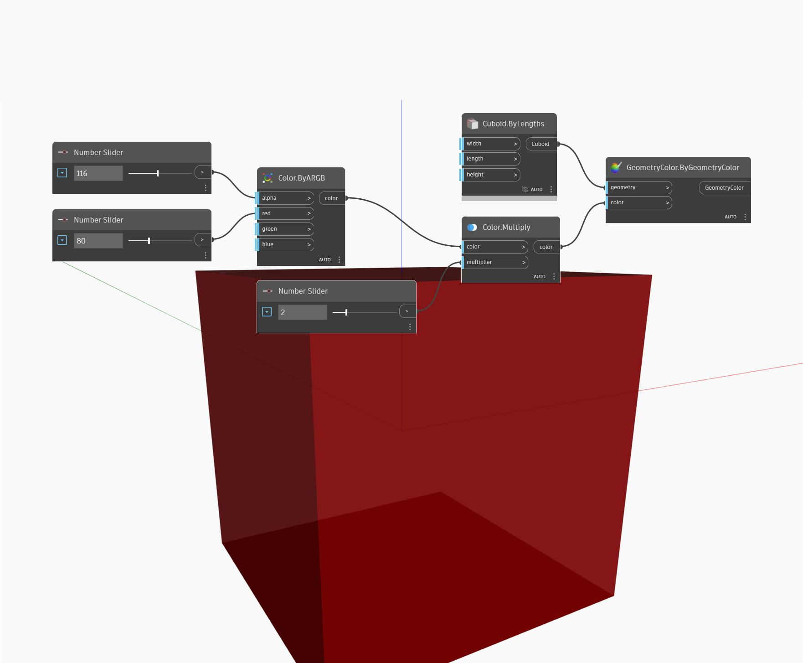

## 상세
Multiply는 색상의 각 채널에 입력 숫자를 곱하고 그 결과 색상을 반환합니다. 1보다 큰 숫자를 곱하면 더 밝은 색상이 만들어집니다. 이때 결과값은 255보다 작아야 합니다. 아래 예제에서는 ByARGB 노드를 사용하여 색상을 만듭니다. 그런 다음 Multiply 노드를 사용하여 숫자 슬라이더로 제어하는 숫자를 색상에 곱합니다. 결과 색상을 시각적으로 확인하기 위해 기본 직육면체와 함께 Display.ByGeometryColor 노드를 사용합니다.
___
## 예제 파일

