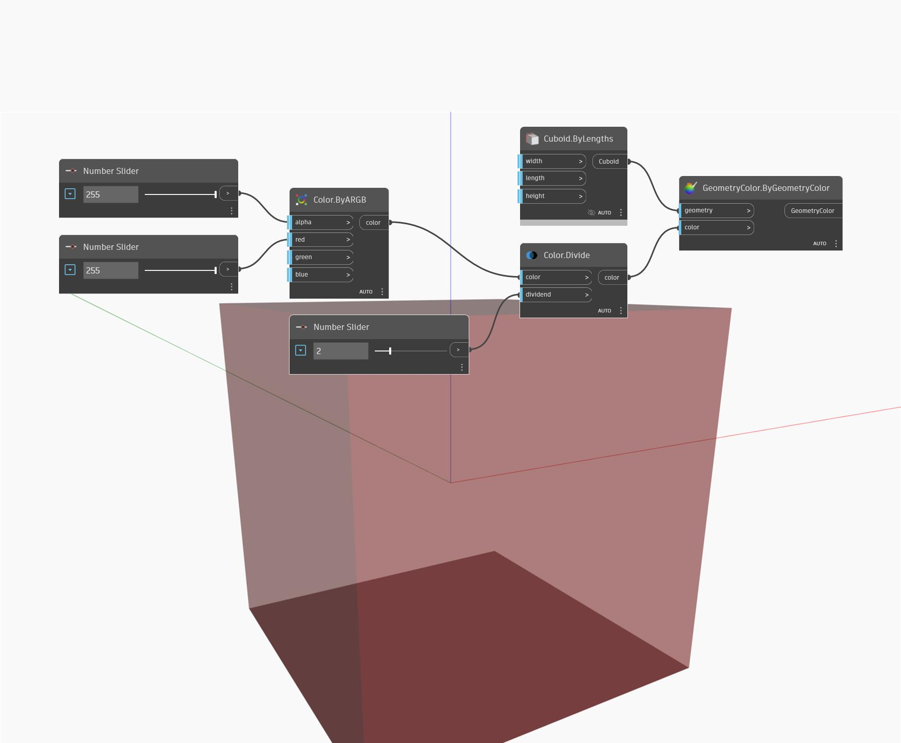

## 详细
“Divide”会将一种颜色的各个通道除以一个输入数字，并返回结果颜色。除以大于 1 的数字会产生更深的颜色。请注意，结果值必须小于 255。在下例中，我们使用“ByARGB”节点创建颜色。然后，我们使用“Divide”节点，将颜色除以“数字”滑块控制的数字。“Display.ByGeometryColor”节点将与默认立方体一起使用，以便直观显示生成的颜色。
___
## 示例文件

